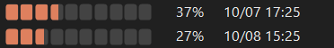
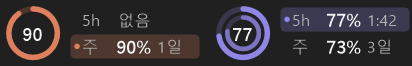

# CodexMeter

A free Windows taskbar and tray monitor for Codex quota remaining and reset times. MIT licensed, with **Classic**, **Expanded** and **Dual** layouts. Dual also shows Claude usage. The application UI is currently Korean; the installer supports English and Korean when the compiler's Korean translation is available.

The tray uses a single numeric icon design. Warning and unknown states still display `!` and `—`.

The tray and floating-window menus share the same settings. **작업표시줄 설정** controls the taskbar bar; **별도 창 설정 → 표시 방식** selects exactly one floating-window layout: Detail, Compact, or Bars. Always-on-top, opacity and position reset apply only to the floating window. Existing preferences and artwork are preserved.

The taskbar submenu shows a separate information footer such as `상태: 표시 중` (Status: visible), including when the meter is hidden because the taskbar has insufficient space.

Display-setting changes preserve the floating window's position. A window outside the available working area is moved back into view; a hidden window stays hidden. Existing layouts and preferences are retained.

**[Download](https://github.com/Mackeabit/CodexMeter/releases/latest)** · [한국어](README.md) · [Privacy](PRIVACY.md) · [License](LICENSE)

This is an independent community project, not an OpenAI or Anthropic product. It displays limits reported by the locally installed Codex CLI/app-server, not all ChatGPT model limits.

| Edition | Layout |
| --- | --- |
| Classic | Compact bars and text with a reset date/time suffix |
| Expanded | A larger single limit, or two vertically stacked limits with reset times |
| Dual | Two concentric-ring gauges for Codex and Claude: outer ring = weekly limit, inner ring = 5-hour limit, center = the 5-hour value (the weekly value when Codex reports no 5-hour limit for the account, or it is used up); beside each ring, two rows (`5h`, `주`) with value and countdown and the shown row highlighted when the taskbar has room, otherwise the shown limit and time to its reset, or `불가` and the time until use resumes when a limit is at 0% |






Download the edition's **Setup-x64.exe** for per-user installation, Start menu integration, optional Windows startup, and an uninstaller. Or extract **Portable-x64.zip** completely and run `CodexMeter.exe`. Both include .NET; Codex itself and its login are required separately. Windows 11 x64 is the validation target. Windows 10 22H2 and ARM64 emulation have not been tested.

All editions share settings and notification history in `%LOCALAPPDATA%\CodexMeter`; only one instance runs at a time. Portable refers to program placement: preferences remain in the Windows user profile. A new setup replaces the installed edition while keeping preferences. Old pre-2.2 version folders are not automatically removed. There is no automatic updater.

The binaries are **unsigned**, so Windows SmartScreen may warn. Use this repository's Releases and compare downloads with `SHA256SUMS.txt`; checksums are not a substitute for code signing.

Below-20% and below-5% notifications are deduplicated per quota/reset cycle, including across restarts. The number of displayed quotas follows server data rather than a plan-name assumption. Reset times use the PC's local time zone. If no safe taskbar space is available, the taskbar meter hides and the tray remains usable.

**Dual and Claude.** Dual reads Claude limits through the locally installed Claude Code CLI (Claude Pro or Max). Install it with `irm https://claude.ai/install.ps1 | iex`, then run `claude auth login`; this login is separate from the Claude desktop app. Codex and Claude refresh together on the tray menu's refresh interval (1, 2 or 5 minutes; Dual defaults to 1 minute). For Claude, each refresh sends one minimal request (Haiku, no tools, MCP or settings, no saved session) and reads the 5-hour and weekly limits that come back with it. **These requests count toward your Claude usage** (about 1k tokens each; up to about 1,440 a day at 1 minute), so pick 5 minutes if that matters. A poll is skipped when the last value is newer than one interval and repeated once after a reset passes. The detail window shows both services with equal weight. Values older than twice the interval (at least 3 minutes) are dimmed; a limit past its reset shows `—` until confirmed. Optionally register `CodexMeter.exe --claude-statusline` as a Claude Code statusLine command to update the value without requests while you use the CLI. Claude gets the same below-20% and below-5% notifications as Codex (titled "Claude 잔여량 …"), deduplicated in its own history; the tray menu's notification toggle and "pause until next reset" apply to both services, and outdated Claude values never trigger a notification.

Build on Windows using .NET SDK 10.0.403 and Inno Setup 6:

```powershell
pwsh -File .\scripts\build.ps1
```

The build downloads Microsoft runtime packages to a project-local NuGet cache, runs synthetic tests, and produces EXE/ZIP files in `dist`. See [verification](docs/VERIFICATION.md) and [third-party notices](THIRD-PARTY-NOTICES.md). Never include authentication files or tokens in issues.

Releases are published by GitHub Actions after a version-bump PR is merged into `main`; see [Releasing](docs/release-notes/README.md).
