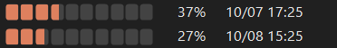

# CodexMeter

Windows 작업표시줄에서 Codex 잔여 사용량과 리셋 시간을 확인하는 작은 무료 앱입니다. 주황색 분할 막대와 숫자 트레이 아이콘을 제공합니다.

**[다운로드 · Releases](https://github.com/Mackeabit/CodexMeter/releases/latest)** · [English](README.en.md) · [개인정보 처리](PRIVACY.md) · [MIT License](LICENSE)

OpenAI와 무관한 커뮤니티 프로젝트입니다. Codex가 반환하는 계정 한도를 표시하며, 일반 ChatGPT 대화의 모든 모델별 사용량을 통합하는 앱은 아닙니다.

## 디자인 선택

| 디자인 | 표시 방식 | 이전 버전 |
| --- | --- | --- |
| **Classic** | 기존의 작은 막대·숫자를 유지하고 오른쪽에 리셋 날짜와 시간을 표시 | 2.0.3 계열 |
| **Expanded** | 한도가 하나면 크게, 두 개면 세로로 정렬. 리셋 날짜와 시간을 함께 표시 | 2.1.2 계열 |




이미지는 실제 계정 정보가 아닌 테스트 데이터입니다. 두 디자인의 기능은 동일하며 설정·알림 기록을 공유합니다. 동시에 실행되지 않으므로 하나를 선택하세요.

## 설치와 실행

지원 대상은 Windows 11 x64이며, Windows 10 22H2 x64는 별도 검증하지 않았습니다. ARM64 네이티브 빌드는 제공하지 않습니다. 이 PC에서 로그인한 Codex와 호환되는 `codex.exe`가 필요합니다. **.NET 실행환경은 포함되어 있어 별도 설치할 필요가 없습니다.**

1. Releases에서 원하는 디자인의 `CodexMeter-2.2.4-Classic-Setup-x64.exe` 또는 `CodexMeter-2.2.4-Expanded-Setup-x64.exe`를 받습니다.
2. 설치 마법사를 실행합니다. 관리자 권한 없이 현재 사용자에게 설치되며, 자동 실행 여부를 선택할 수 있습니다.
3. 시작 메뉴에서 Codex Meter를 실행합니다. Codex를 찾지 못하면 트레이 메뉴의 **연결 및 자동 실행**에서 자동 탐색하거나 CLI용 `codex.exe`를 선택하세요.

설치 대신 **Portable-x64.zip**을 선택해 폴더 전체를 풀고 `CodexMeter.exe`를 실행해도 됩니다. EXE만 따로 옮기면 실행되지 않습니다. 포터블은 프로그램 파일만 이동 가능하며, 설정은 Windows 사용자별 `%LOCALAPPDATA%\CodexMeter`에 저장됩니다. 다른 PC의 Codex 로그인은 별도로 필요합니다.

현재 배포 EXE는 **코드 서명이 없습니다**. Windows SmartScreen의 알 수 없는 게시자 경고가 나타날 수 있습니다. 이 저장소의 Releases에서 받았는지 확인하고, 배포된 `SHA256SUMS.txt`와 해시를 비교할 수 있습니다. 해시는 코드 서명을 대신하지 않습니다.

```powershell
Get-FileHash .\CodexMeter-2.2.4-Classic-Setup-x64.exe -Algorithm SHA256
```

## 사용법

- 트레이 메뉴와 창의 설정 메뉴는 같은 구성을 사용합니다. **작업표시줄 설정**에서 분할 막대를 켜거나 끄고, **별도 창 설정 → 표시 방식**에서 `상세 / 작게 / 막대` 중 하나를 선택합니다. 항상 위에 표시·불투명도·위치 초기화는 별도 창에만 적용됩니다.
- 작업표시줄 설정의 구분선 아래에는 `상태: 표시 중` 같은 안내 문구가 나타납니다. 공간 부족으로 막대가 숨겨진 경우에도 이곳에서 상태를 확인할 수 있습니다.
- 트레이 아이콘을 클릭하면 별도 창을 표시하거나 숨깁니다. 숫자 아이콘 디자인과 조회 실패·미확인 상태의 `!`·`—` 표시는 유지합니다.
- 화면 구성이 바뀌어도 별도 창의 위치를 유지합니다. 창이 작업 영역 밖으로 벗어난 경우에만 화면 안으로 위치를 보정하며, 숨겨둔 창을 임의로 표시하지 않습니다.
- 한도 개수는 Pro/Plus 이름으로 추정하지 않고 Codex가 실제 제공한 데이터로 결정합니다. 리셋 시각은 **현재 PC의 현지 시간**입니다.
- 잔여량 20% 미만, 5% 미만 알림은 각 한도의 리셋 주기에서 단계별 한 번씩 표시합니다. 재조회·재시작으로 같은 알림을 반복하지 않습니다.
- 조회 실패 시 이전 수치를 최신인 것처럼 표시하지 않고 갱신 실패를 알립니다. 서버가 새 사용량을 반환하기 전에는 리셋을 임의로 100%로 바꾸지 않습니다.
- 작업표시줄에 충분한 공간이 없으면 막대를 숨깁니다. 트레이 아이콘과 상세 화면은 계속 사용할 수 있습니다. Windows 업데이트나 작업표시줄 교체 프로그램에 따라 막대 배치가 동작하지 않을 수 있습니다.

## 업데이트·이전 버전에서 이동

새 Setup EXE를 실행하면 실행 중인 CodexMeter에 정상 종료를 요청한 뒤 새 파일과 시작 메뉴 바로가기를 설치합니다. 종료되지 않으면 덮어쓰지 않고 종료 후 재시도를 안내합니다. 설정과 중복 알림 방지 기록은 유지합니다.

Classic과 Expanded는 같은 설치 위치를 사용합니다. 다른 디자인의 Setup을 실행하면 디자인이 교체됩니다. 자동 실행은 설치 화면에서 선택하며, 기존 자동 실행 바로가기가 있으면 선택 상태로 시작합니다. Windows 작업 관리자에서 따로 비활성화한 상태는 강제로 해제하지 않습니다.

이전 `Install.cmd` 방식으로 생성된 `versions` 폴더와 사용자가 보관한 배포 ZIP은 자동 삭제하지 않습니다. 새 버전 정상 실행을 확인한 뒤 필요 없는 옛 배포 폴더를 직접 정리할 수 있습니다. `--install`은 기존 스크립트 호환용이며 새 설치에는 **Setup EXE를 사용하세요**.

제거는 Windows **설정 → 앱 → 설치된 앱 → CodexMeter → 제거**에서 합니다. 프로그램과 설치한 바로가기를 제거하고 사용자 설정·알림 기록은 남깁니다. 포터블에서 자동 실행을 등록했다면 앱에서 등록 해제한 후 폴더를 삭제하세요. 포터블 폴더를 옮겼다면 자동 실행을 다시 등록해야 합니다.

자동 업데이트는 아직 제공하지 않습니다. 포함된 .NET의 보안 업데이트도 새 CodexMeter 배포본에 포함되므로 Releases에서 새 버전을 확인하세요.

## 소스에서 빌드

Windows, .NET SDK **10.0.403**, Inno Setup 6가 필요합니다. 첫 빌드는 NuGet에서 Microsoft 런타임 패키지를 다운로드합니다. 프로젝트의 `.nuget` 폴더에 캐시하며 글로벌 .NET 설치를 수정하지 않습니다.

```powershell
pwsh -File .\scripts\build.ps1
# 설치 파일 없이 포터블만:
pwsh -File .\scripts\build.ps1 -Edition Classic -SkipInstaller
# 별도 SDK나 Inno 경로:
pwsh -File .\scripts\build.ps1 -DotNet C:\tools\dotnet\dotnet.exe -ISCC 'C:\Program Files (x86)\Inno Setup 6\ISCC.exe'
```

결과는 `dist`, 테스트 보고서는 `artifacts`에 생성됩니다. 스크립트는 기존 배포 파일을 덮어쓰지 않습니다. 재빌드하려면 해당 배포 파일을 별도 폴더로 보관하거나 버전을 올리세요. `src/Common`은 공통 코드, `src/Editions`는 두 디자인입니다.

기본 빌드는 합성 데이터로 파서·화면 렌더링·경로 탐색·알림 정책을 검사하며 실제 계정에 접속하지 않습니다. 설치·교체·제거 검증 방법은 [검증 문서](docs/VERIFICATION.md)에 있습니다.

## 라이선스와 제보

앱 소스는 [MIT](LICENSE)로 사용·수정·재배포할 수 있습니다. 포함된 .NET 및 관련 구성요소의 라이선스는 배포 폴더의 `licenses`에 있습니다. [제3자 고지](THIRD-PARTY-NOTICES.md)를 참고하세요.

버그는 [Issues](https://github.com/Mackeabit/CodexMeter/issues)에 Windows 버전, CodexMeter 디자인/버전, 재현 방법을 적어 주세요. 로그인 파일·인증 토큰·계정 정보는 올리지 마세요.
